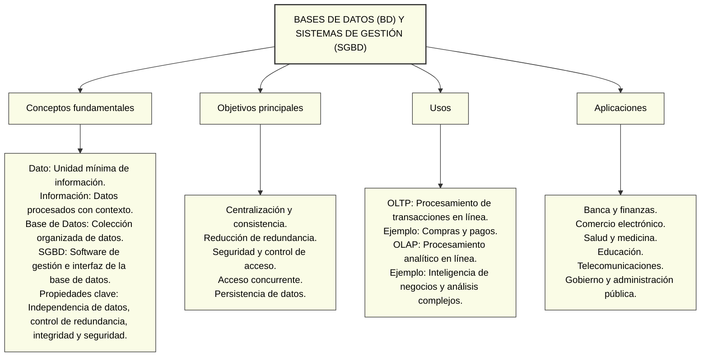

# Tarea 1.1 - Bases de Datos y Sistemas de Gestión

## Descripción

En esta actividad se presenta un diagrama sobre las bases de datos (BD) y los sistemas de gestión de bases de datos (SGBD), sus conceptos fundamentales, objetivos principales, usos y aplicaciones.

## Diagrama Mermaid

