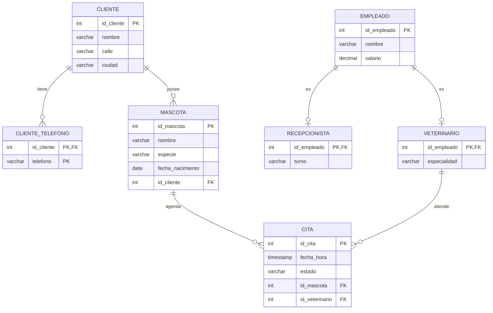

# Esquema Relacional — Clínica Veterinaria "Patitas Felices"

## Notación Formal del Esquema
* **cliente** (**id_cliente**, nombre, calle, ciudad)
* **cliente_telefono** (**id_cliente**, **telefono**) — *FK (`id_cliente`) -> `cliente(id_cliente)`*
* **empleado** (**id_empleado**, nombre, salario)
* **veterinario** (**id_empleado**, especialidad) — *FK (`id_empleado`) -> `empleado(id_empleado)`*
* **recepcionista** (**id_empleado**, turno) — *FK (`id_empleado`) -> `empleado(id_empleado)`*
* **mascota** (**id_mascota**, nombre, especie, fecha_nacimiento, *id_cliente*) — *FK (`id_cliente`) -> `cliente(id_cliente)`*
* **cita** (**id_cita**, fecha_hora, estado, *id_mascota*, *id_veterinario*) — *FK (`id_mascota`) -> `mascota(id_mascota)`*, *FK (`id_veterinario`) -> `veterinario(id_empleado)`*

## Diagrama Relacional (Mermaid)

