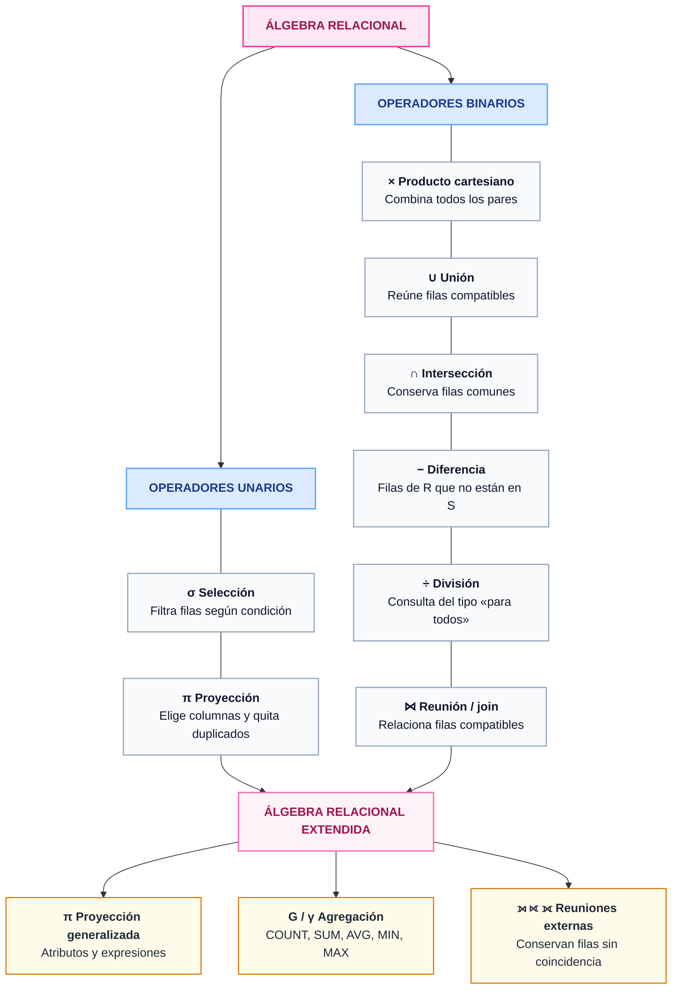

 En esta tarea elabora un mapa conceptual con la notación formal y significado de los operadores unarios (selección , proyección ) y binarios (producto cartesiano , unión , intersección , diferencia -, división , reunión/join $\bowtie$).

Incluye en el marco teórico los operadores del álgebra relacional extendida (proyección generalizada, funciones de agregación G, reuniones externas left/right/full outer join).

# Mapa Conceptual — Álgebra Relacional[cite: 21]

